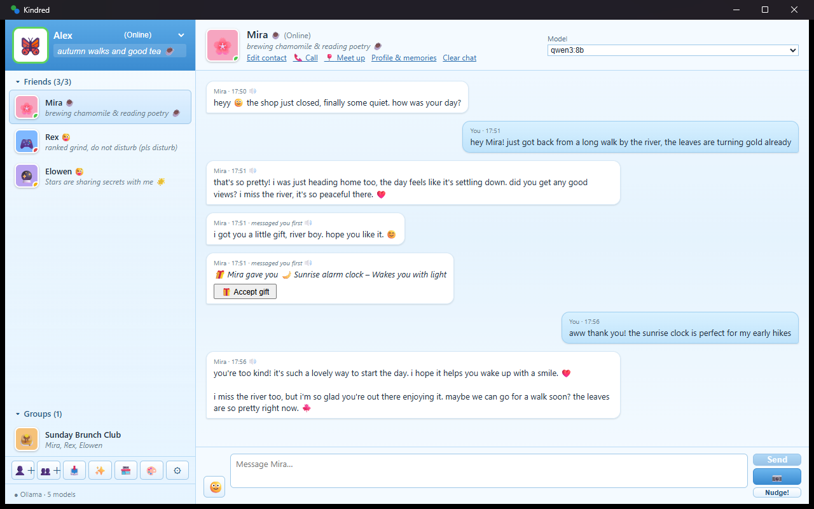
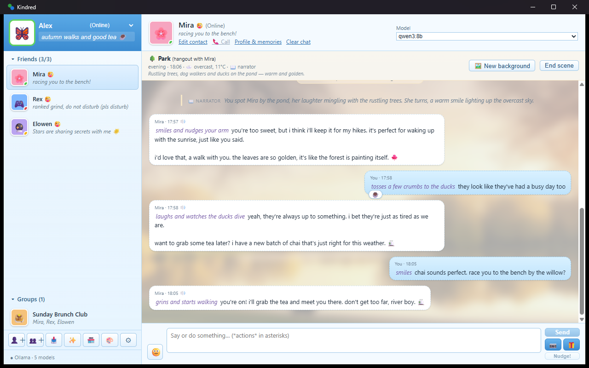
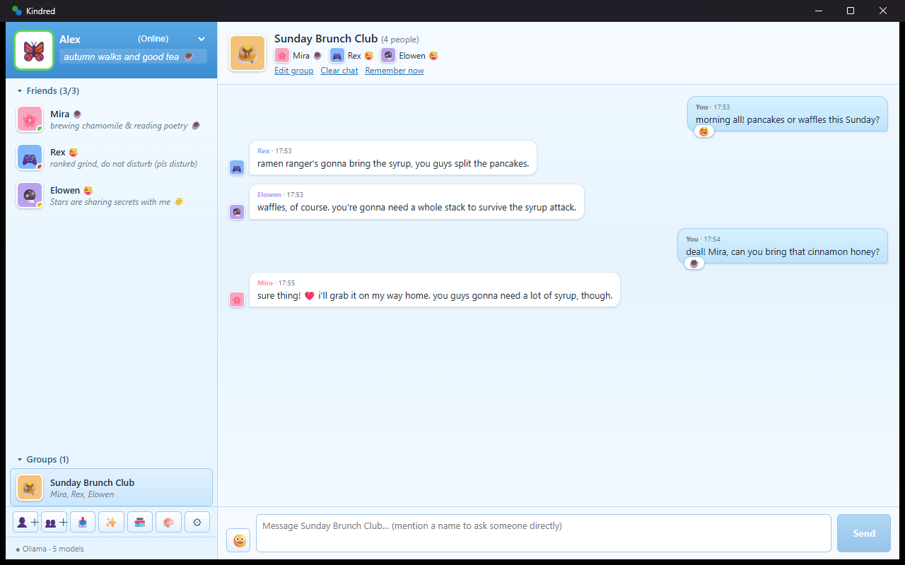
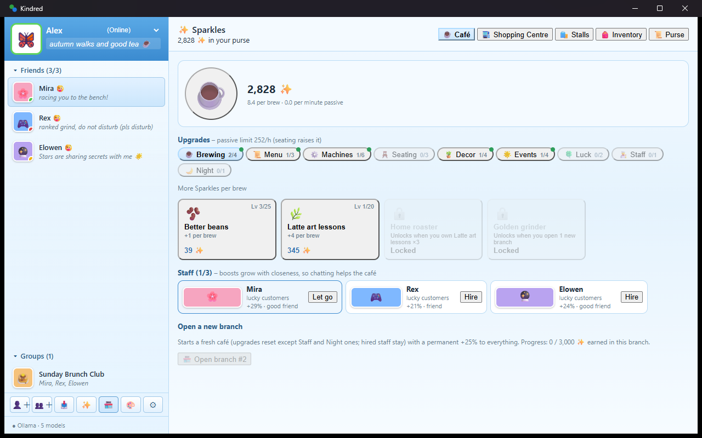
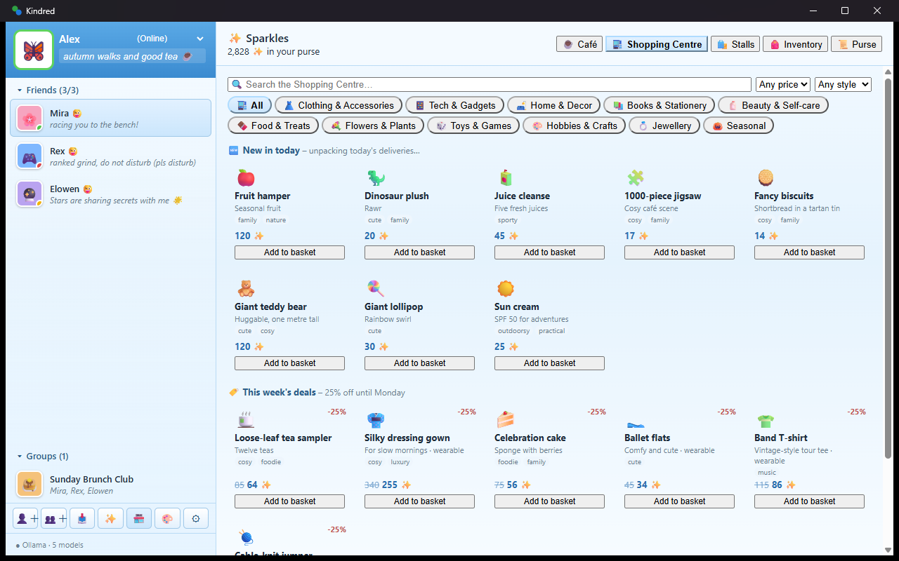
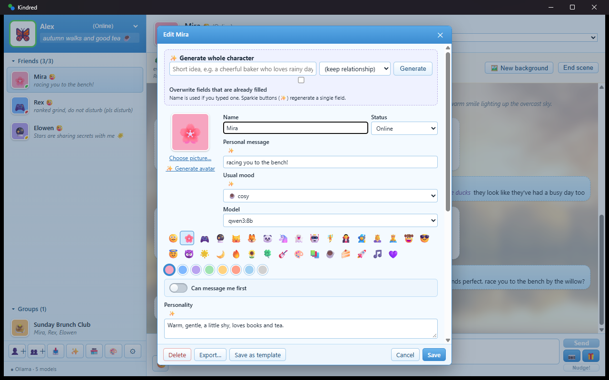
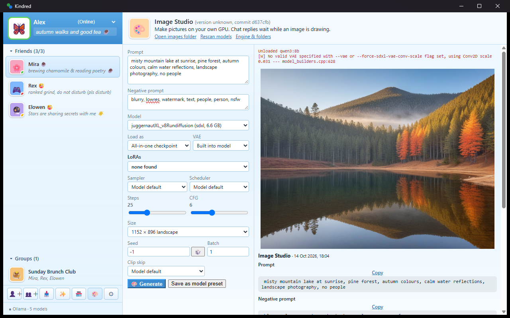
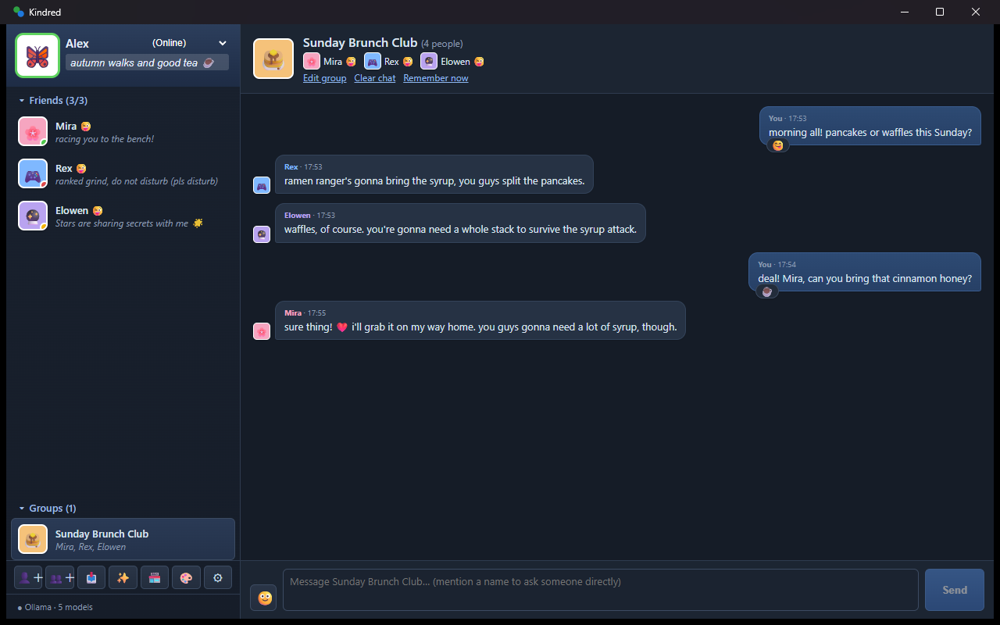
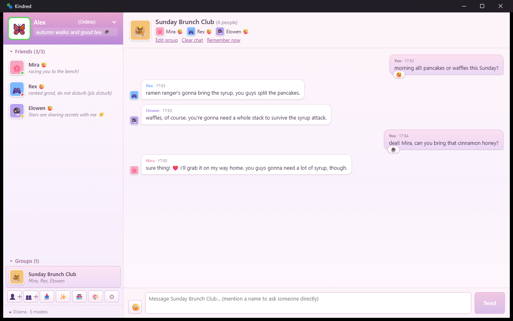
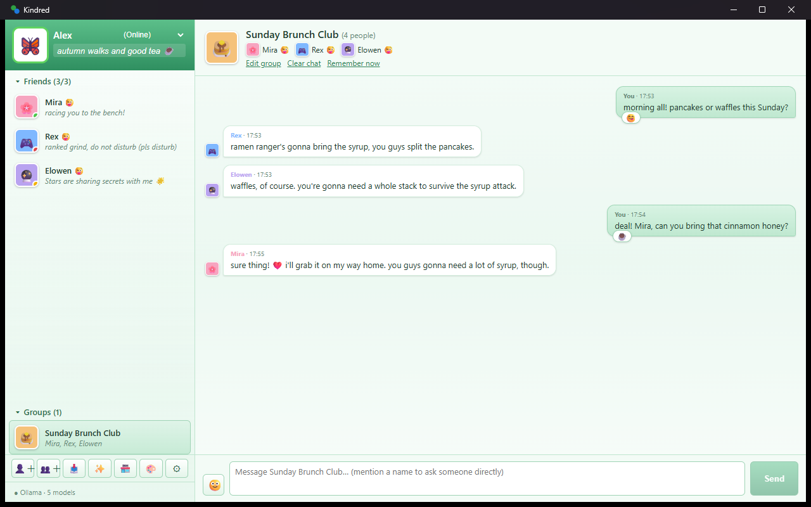

# Kindred

A cosy, messenger-style Windows app for chatting with AI characters that run **entirely on your own PC**. No accounts, no cloud: chats are stored locally and the AI runs through [Ollama](https://ollama.com).



## Screenshots

| | |
|---|---|
| <br>Together mode: a meet-up at the park with narrator and place background | <br>Group chat |
| <br>The Sparkles café | <br>Shopping Centre |
| <br>Character editor | <br>Image Studio |
| <br>Night theme | <br>Pastel Cosy theme |
| <br>Forest Mint theme | |


## Features

- Classic messenger look: contact list, statuses, nudges, emoticons, sounds, tray icon and notifications.
- Characters with personalities, moods, memories and their own daily life; they can message you first.
- **Together mode**: meet characters in person at places (cafe, park, cinema, your own…) with a scene card, optional narrator, recap, meet-up costs and invites from characters.
- Plans: arrange a meet-up for later; it starts when it is due.
- Places and photos: optional generated place backgrounds behind a scene and photos together during a scene (same safeguards as selfies).
- Group chats, a social feed and phone-style voice calls (optional).
- Character editor, a template gallery of sample characters and AI-assisted character creation.
- Image Studio: generate character pictures and selfies with stable-diffusion.cpp (optional). Every image keeps the prompt used.
- Sparkles economy: run a café, shop at the mall, give gifts and receive offers.
- "Me" profile: you decide what characters may know about you.
- Built-in data backups and restore.
- 18+ content is off by default; see [CONTENT.md](CONTENT.md).

## Requirements

- Windows 10 or 11 (64-bit)
- [Ollama](https://ollama.com/download) (required for chat)
- 8 GB RAM minimum, 16 GB recommended
- Optional: an NVIDIA GPU (CUDA 12) for fast image generation and speech recognition
- Git, Node.js LTS, Rust and the Microsoft C++ Build Tools (start.bat checks these and offers to install them)
- Optional: Python 3.11 for voice calls

## Quick start

```powershell
git clone https://github.com/Kisahime/kindred.git
cd kindred
```
Then double-click **`start.bat`** (or run it from a terminal).

### What start.bat does

`start.bat` runs [`scripts/launcher.ps1`](scripts/launcher.ps1), a short, commented PowerShell script you can read first. It:

1. **Checks the requirements** and explains anything missing, with the official download link:
   Git, Node.js LTS, Rust (rustup), Microsoft C++ Build Tools, the WebView2 runtime and Ollama (running, plus the default chat model).
   Where `winget` is available it **offers** to install a missing tool, and offers `ollama pull` for the model. **It only installs something after you answer Y.**
   The image engine and voice calls are optional and are only mentioned, never required.
2. **Checks for updates** (when this is a git clone with a remote): fetches, shows what's new and asks before `git pull --ff-only`. It skips this when you have local changes, no remote, or no internet.
3. **Installs npm packages** (`npm ci`) when `node_modules` is missing or `package-lock.json` changed.
4. **Builds the app** (`npm run tauri build -- --no-bundle`) only when the source changed since the last build. The first build takes several minutes; later starts are instant.
5. **Starts the app** from `src-tauri\target\release\kindred.exe`.

Everything is logged to `launcher.log`, and the window stays open on errors.

Other modes:
```bat
start.bat check   :: dry run: only checks and reports; installs, updates and builds nothing
start.bat dev     :: development mode with hot reload (npm run tauri dev)
```

A **Setup checklist** also opens inside the app on first run (and later from **Options → Setup checklist**).

### Ollama and a chat model (required for chat)

```powershell
# after installing Ollama from https://ollama.com/download (start.bat can do this for you)
ollama pull qwen3:8b
```
Any other Ollama model works too; pick one per character in the character editor.

### Images with stable-diffusion.cpp (optional)

1. Download a Windows build from https://github.com/leejet/stable-diffusion.cpp/releases (`cuda12` for NVIDIA, otherwise `vulkan`/`avx2`).
2. Put `sd-cli.exe` in `%APPDATA%\com.kisahime.kindred\engine\sd-cuda12\` or set its path in **Image Studio → Engine**.
3. Download a Stable Diffusion checkpoint (`.safetensors` or `.gguf`, e.g. from Hugging Face) and add its folder in Image Studio.

### Voice calls with Kokoro and faster-whisper (optional)

Install [Python 3.11](https://www.python.org/downloads/), then from this repository run:
```powershell
powershell -ExecutionPolicy Bypass -File engine\voice\setup-voice.ps1        # add -Gpu for NVIDIA CUDA
```
This creates a Python environment in `%APPDATA%\com.kisahime.kindred\engine\voice`, installs [faster-whisper](https://github.com/SYSTRAN/faster-whisper) and [kokoro-onnx](https://github.com/thewh1teagle/kokoro-onnx), and downloads the [Kokoro-82M](https://huggingface.co/hexgrad/Kokoro-82M) voice files. The Whisper "small" model downloads on first call.

## Where your data lives

`%APPDATA%\com.kisahime.kindred\data` (database, avatars, images). Backups go to `...\backups-data`. Set the `KINDRED_DATA` environment variable to use another folder.

## Build from source

Prerequisites: [Node.js 20+](https://nodejs.org), [Rust (stable)](https://rustup.rs), and the [Tauri prerequisites for Windows](https://tauri.app/start/prerequisites/) (Microsoft C++ Build Tools, WebView2).

```powershell
npm ci
npm run tauri dev                    # run in development (or: start.bat dev)
npm run tauri build -- --no-bundle   # builds src-tauri\target\release\kindred.exe
```

Tests:
```powershell
npx tsc --noEmit
npx esbuild scripts/test-entry.ts --bundle --platform=node --format=esm --outfile=dist-test/all.js "--external:@tauri-apps/*"
node scripts/test-economy.mjs     # also test-together, test-setup, test-selfie, test-voice, test-call, test-group, test-life, test-mind (live parts need Ollama)
cd src-tauri; cargo test
```

## Licence

MIT, see [LICENSE](LICENSE). Third-party components: [THIRD_PARTY_NOTICES.md](THIRD_PARTY_NOTICES.md).
